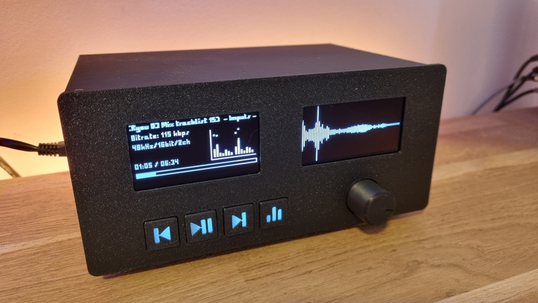
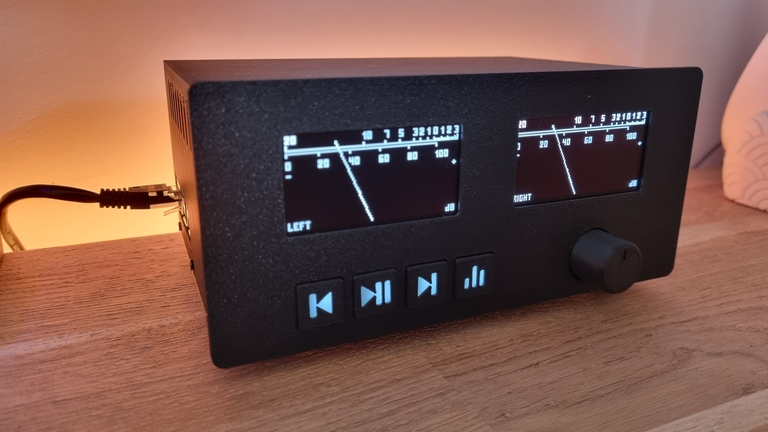
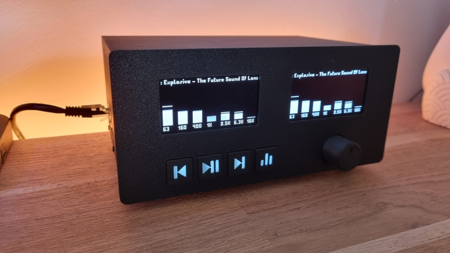
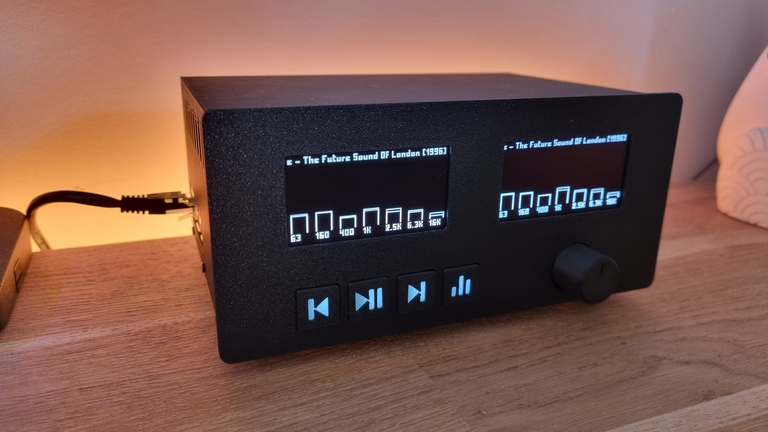
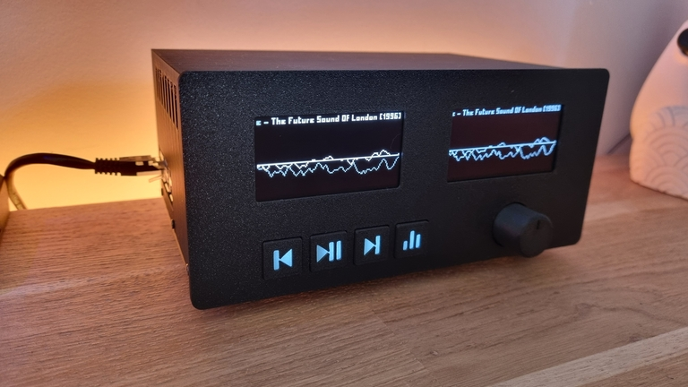
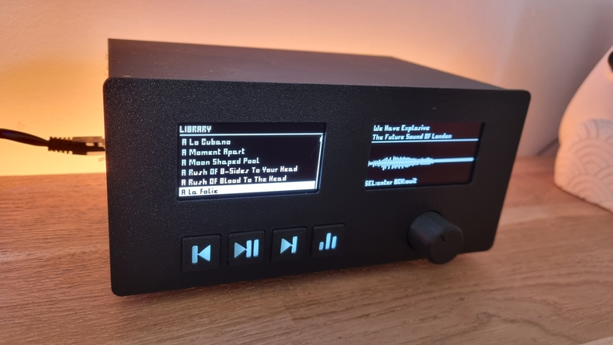
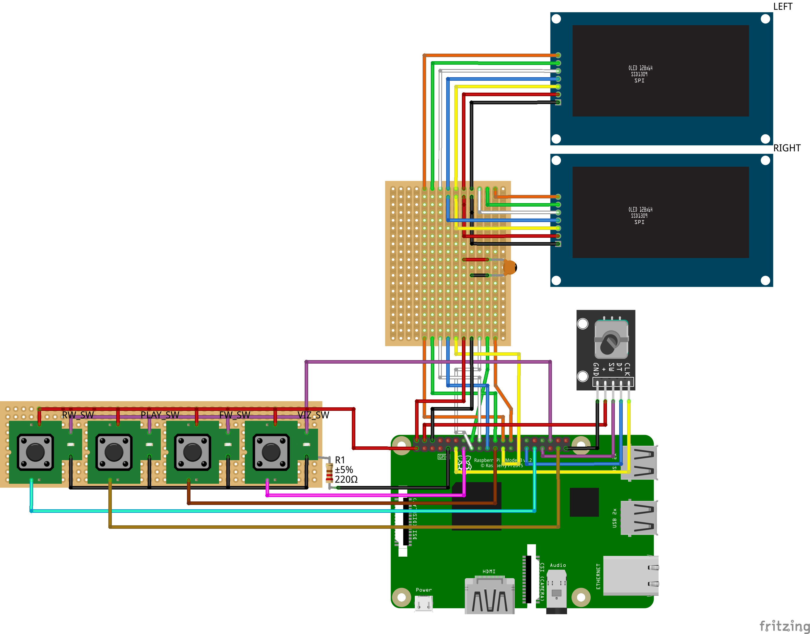

# Raspberry Audio Visualizer

A real-time stereo audio visualizer for the Raspberry Pi that drives **two OLED panels** over SPI, one per channel: either **SSD1309 128×64 monochrome** or **SSD1322 240×128 greyscale**. Written in Rust (`rust/`), it runs on the Raspberry Pi 3 and 5 alike.

The project combines live FFT analysis of what the box is playing, an MPD client, Bluetooth (A2DP + AVRCP) support and a small physical control surface (rotary encoder + four buttons) into a standalone "hi-fi display" appliance. A Debian package sets up the whole audio stack around it.
---

---

## Features

- **One program, two panel types**, chosen in `/etc/rav-audio/visualizer.conf`; each panel has its own set of visualizations drawn for its resolution
- **Two independent OLEDs**: left and right channels rendered separately
- **PipeWire capture** of the output's monitor: shows exactly what is played (MPD, Bluetooth, anything else) and lets the output suspend when idle
- **Three-resolution FFT** (bass / mid / treble) for fine bass bins and fast treble, synced to the moment the sound reaches the speakers
- **7-band and 64/120-band spectrum analyzers** with peak-hold, smoothing and gravity decay
- **MPD integration**: now-playing info, play/pause, next/previous, volume and a built-in library browser (queue, artists, albums, folders, stored playlists, database update)
- **Bluetooth A2DP**: track metadata, MPD auto-pause when a phone starts streaming; while a phone is the active source, the transport buttons and the knob drive it (AVRCP)
- **Sleep mode**: after 10 s of silence both panels collapse with a CRT-style animation; they wake when audio returns
- **"Matrix rain" transition** between visualizations, and **power off** by holding PLAY

---

## Visualization Modes

### SSD1309 (128×64 monochrome)

| Mode | Description |
|---|---|
| **VU Meter** | Analog-style needle on a dB scale (−20 to +3 dB) |
| **Spectrum** | 7-band filled bars with peak markers and frequency labels (63 Hz → 16 kHz) |
| **Empty Spectrum** | Same 7 bands, outline-only style |
| **Waveform** | Time-domain oscilloscope trace |
| **Track Info** | Scrolling title, bitrate/format, elapsed/total time, progress bar, mini spectrum, plus a 64-band spectrum on the right panel |
| **Playlist Editor** | Menu: queue (jump to a song), artists, albums, folders, stored playlists, database update; play now or add to queue |









### SSD1322 (240×128, 16 grey levels)

VU Meter, VU Vintage (arc dial), VU Studio (segmented bargraph), Spectrum (dithered gradient bars), Spectrum LED, Spectrum HD (30 bars from 120 bands), Empty Spectrum, Waveform, Point Cloud (rotating 3D cloud), Terrain (3D spectral landscape), Track Info and the Playlist Editor, plus two hidden modes reached by holding VIZ.

A volume overlay is drawn over the current visualization whenever the rotary knob is turned.

---
## Parts list
- 1 Raspberry pi 3B or 5
- 1 Rotary encoder 
- 2 128x64 waveshare SPI OLED screens white
- 4 momentary pushbuttons
- 4 smd1206 LEDs 6000k
- 1 100nF capacitor
- 1 220ohms resistor
- Board for screens
- 2*8cm Board for pushbuttons
- Optional: Audio HAT for RPI 5

---
## 3D printed parts
- M2.5 Threaded Insert
- M2.5×8mm screws
- Feet Stickers, 18 x 10 mm Rubber Pads Self Adhesive Half Sphere

---
## wiring



---
## Hardware

### Displays
- 2× SSD1309 OLED, 128×64, SPI mode, **or**
- 2× SSD1322 OLED, 240×128, SPI mode (4-wire)

### GPIO Pinout (BCM numbering)

| Function | Pin | Function | Pin |
|---|---|---|---|
| Left display CS | 8 (CE0) | Right display CS | 7 (CE1) |
| Left display DC | 25 | Right display DC | 23 |
| Left display RST | 24 | Right display RST | 22 |
| Rotary CLK | 17 | Rotary DT | 5 |
| Rotary switch | 13 | Viz switch | 27 |
| Play/Pause button | 26 | Prev button | 6 |
| Next button | 4 | Power LED | 16 |

The Next button used to be on GPIO 9, but that is also SPI0 MISO, which the kernel keeps for the SPI driver: wire it to GPIO 4 (physical pin 7). SPI runs at 6.25 MHz for the SSD1309 and 20 MHz for the SSD1322.

### Controls

| Input | Action |
|---|---|
| Rotary knob | Volume ±2 (MPD, or the phone's own volume while it is the active source) / scroll list (editor) |
| Rotary push | Open the Playlist Editor menu / confirm selection |
| Viz button | Next visualization / one level up in the editor (SSD1322: hold to visit the hidden modes) |
| Play button | Play / pause (MPD or phone); **hold 3 s to power the box off** |
| Next / Prev buttons | Skip track (MPD or phone) |

---

## Installation (Debian package)

`packaging/build-deb.sh` compiles the visualizer and packs it with the whole audio stack configuration into `rav-audio_<version>_arm64.deb` (Debian 13 / Raspberry Pi OS trixie, arm64):

```bash
sudo apt install cargo rustc libclang-dev libpipewire-0.3-dev libfreetype-dev pkg-config
packaging/build-deb.sh 2.0.0
sudo apt install ./packaging/rav-audio_2.0.0_arm64.deb   # pulls in all runtime dependencies
```

The package:
- runs MPD and Bluetooth A2DP through a PipeWire instance owned by user `mpd`;
- installs the visualizer as `audio-visualizer.service`, running as user `mpd` with the `gpio` and `spi` groups (no root);
- works with a HifiBerry (or any I2S DAC) or the onboard headphone jack.

Then:
- choose the panel type with `display = ssd1309` or `ssd1322` in `/etc/rav-audio/visualizer.conf`;
- set your `music_directory` in `/etc/rav-audio/mpd.conf`;
- make sure `config.txt` has `dtparam=spi=on` and an audio output (`dtoverlay=hifiberry-…` or `dtparam=audio=on`).

The SSD1322 layouts use the FreePixel font, which is not shipped: copy `FreePixel.ttf` to `/usr/local/share/rav-audio/`, otherwise DejaVu Sans is used. The SSD1309 font (`trixel-square.ttf`) is included. See `packaging/root/usr/share/doc/rav-audio/README` for exactly what the package sets up.

---

## Building and running from source

```bash
cd rust
cargo build --release          # on a Raspberry Pi 3 (1 GB): cargo build --release -j 1
```

Debian 13's Rust (1.85) is enough; `.cargo/config.toml` makes cargo pick dependency versions that support it. On a Pi 3 the first build takes about 30 minutes, and the parallel LTO link runs out of memory without `-j 1`.

```bash
sudo systemctl stop audio-visualizer
cd /usr/share/rav-audio      # the fonts are looked up in the working directory
sudo env PIPEWIRE_RUNTIME_DIR=/run/user/$(id -u mpd) RAV_DISPLAY=ssd1309 /path/to/rust/target/release/rav-visualizer
```

`RAV_DISPLAY` overrides the config file. `SIGINT` / `SIGTERM` shut down cleanly: threads joined, panels cleared and put to sleep.

**Offline render check.** `cargo test --release render -- --nocapture` drives every visualization of both panel types with synthetic audio and writes them as PNG files to `rust/target/render/`, as the panels would show them. No hardware is needed.

---

## Architecture

```
            PipeWire (sink monitor)    MPD (TCP)     BlueZ (D-Bus)
                     │                     │               │
              capture thread          mpd thread      bt threads
                     │                     │               │
                     ▼                     ▼               ▼
            audio ring + FFTs     ─────▶ FrameSnapshot ◀─────
                                          │  (one per frame)
                                          ▼
          profile ──▶ visualizations (SSD1309 or SSD1322 family)
                                          │
                                          ▼
                       Canvas (grey 0-15) ×2 ──▶ panel driver ──▶ spidev
                                                 (SSD1309: 1-bit pages,
                                                  SSD1322: 4-bit, writer thread)
          GPIO (gpiocdev): buttons, rotary encoder (edge events), LED
```

### Threads

| Thread | Role |
|---|---|
| Main | Rendering loop (~60 FPS), controls, sleep/wake, transitions |
| PipeWire | Stream callback → ring buffer; measures the DAC delay; reconnects if PipeWire restarts |
| MPD | `idle player` loop + 1 s status refresh |
| Bluetooth | D-Bus signals (PropertiesChanged, InterfacesRemoved) + AVRCP command worker |
| Encoder | Kernel edge events for the rotary encoder and its button |
| SPI writer (SSD1322) | Sends frame N while frame N+1 is rendered |
| Editor load | Async library queries, so the UI never blocks |

### Audio pipeline

1. PipeWire delivers the output's monitor (passive stream, F32 stereo at 44.1 kHz).
2. Samples land in a ring buffer. The monitor runs ahead of the speakers by the DAC's buffer, measured live from `/proc/asound`, so the analysis windows can be centred on the sample that will be audible when the frame lights up.
3. Three FFTs per channel pair (left + right packed in one complex FFT): bass (4096 points on the SSD1309, 8192 on the SSD1322), mid (2048) and treble (512).
4. Each band sums its bins, applies a per-band correction curve, then an integral filter on the way up and a gravity decay on the way down, before being clamped to 0–255.

### Sleep mode

After 10 s below the silence threshold both panels play a CRT-collapse animation (vertical pinch → horizontal line → dot), go to sleep (`0xAE`) and the power LED turns off. Audio, or any button press, reverses it.

---

## Project Layout

```
rust/src
├── main.rs, app.rs   — startup, controls, main loop, CRT animation, sleep, power off
├── profile.rs        — the two panel profiles (geometry, pins, fonts, FFT, features...)
├── display/          — grey-level Canvas + SSD1309 and SSD1322 drivers
├── viz/              — Viz trait, playlist editor (shared, one layout per panel)
│   ├── ssd1309/      — the 128×64 visualizations
│   └── ssd1322/      — the 240×128 visualizations
├── audio.rs, bands.rs — PipeWire capture and FFT analysis, band tables
├── mpd.rs            — minimal MPD client
├── bluetooth.rs      — BlueZ over D-Bus (zbus): metadata, AVRCP, volume
├── font.rs, ui.rs    — FreeType glyph cache, scrolling titles, dithering
├── transition.rs     — "Matrix rain" between visualizations
├── hw.rs, rotary.rs  — gpiocdev / spidev, encoder decoding
└── render_test.rs    — offline PNG render check
packaging/            — Debian package (build-deb.sh, files, maintainer scripts)
```

The original C++ implementation (`rav_unified.cpp`, SSD1309 only) is in the git history up to rav-audio 2.0.4. `bluetooth_a2dp_setup.txt` describes the older bluez-alsa Bluetooth setup.

---

## Notes & Tweaks

- **Frame rate** is ~60 FPS (16 ms frame time); unchanged frames are not sent to the panels.
- **Auto-cycle**: after 30 s without a manual change, the next visualization comes up every 10 minutes (the editor and hidden modes are skipped).
- **MPD host/port** are `localhost:6600` (`App::new`).
- **Panel parameters** (pins, SPI speed, fonts, FFT size, enabled features) live in `rust/src/profile.rs`.

## Inspirations
- CAVA: https://github.com/karlstav/cava
- VU_meter: https://github.com/adamples/VU_meter/
- Digital VU Meter with Analog Physics: https://hackaday.io/project/181004-digital-vu-meter-with-analog-physics
